  

## Hey, I'm Yash 👋

A creative developer and an engineering student at **DSCE**, Bengaluru, with a soft spot for interfaces that feel effortless and motion that makes people say *"wait, do that again."*

I like building things people genuinely enjoy using: clean layouts, smooth animations, and the occasional feature nobody asked for but everybody ends up using. If a button can have a satisfying click, I will find a way to give it one.

## A few things about me

- 🎓 Studying at DSCE, where deadlines are always closer than they appear.
- 🎨 Firm believer that good design is like a good joke: if you have to explain it, it isn't working.
- 🌙 Most productive at 4 AM. Least productive at 4:05 AM.
- 🐛 Every bug is just a feature that hasn't introduced itself yet.
- ☕ Powered by chai, curiosity and a heroic amount of Ctrl+Z.

## Toolbox

  
  
  
  
  
  
  
  
  
  

---

Thanks for stopping by. Go drink some water. 💧

